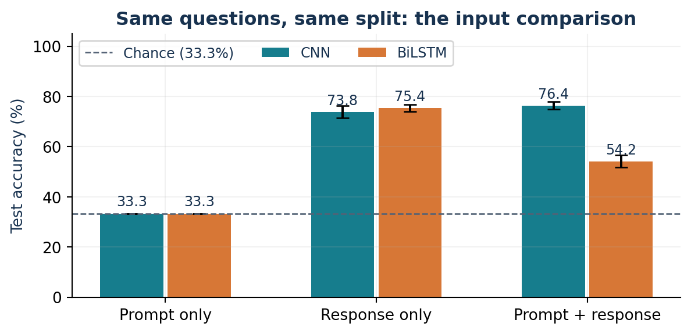
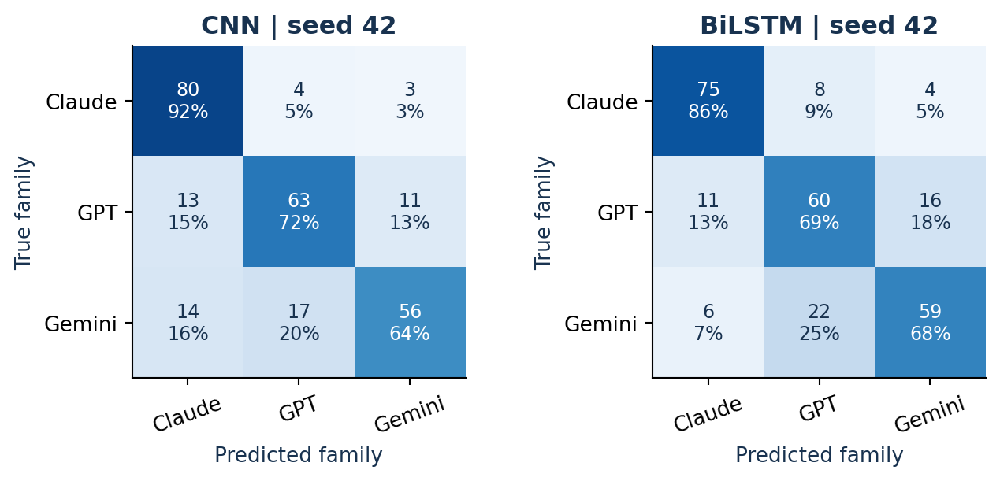
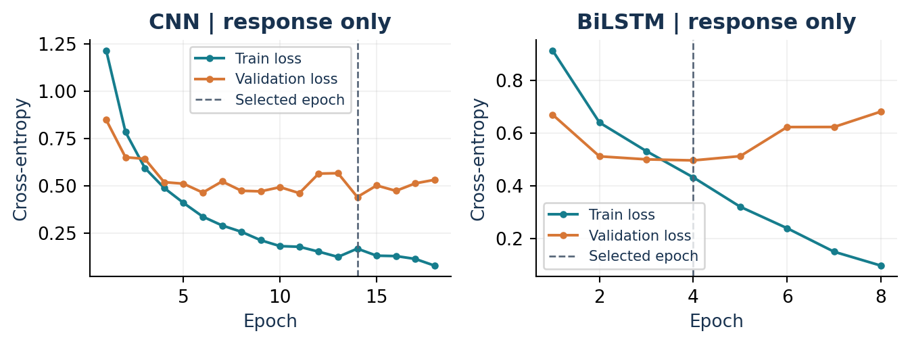
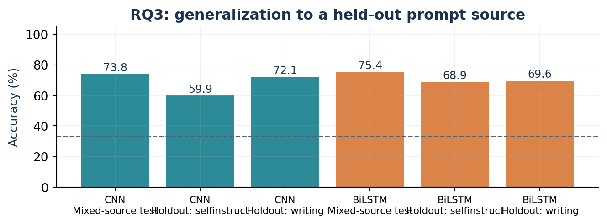
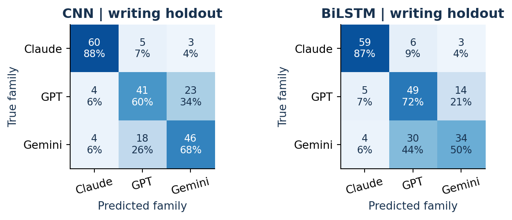
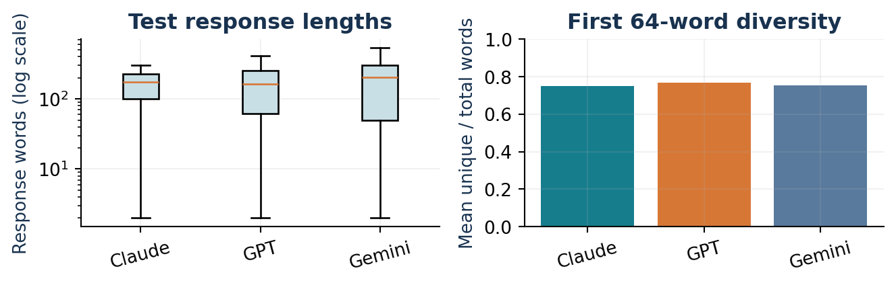

WHO WROTE IT?

Identifying LLMs from Their Responses

A matched-prompt study of CNN and recurrent neural text classifiers

| Team leader | Team member | Course / date |
| --- | --- | --- |
| Kiseong Kim | Jisung Park | CMPSC 448 / 2026-10-11 |

### Abstract

This project classifies the generating LLM family from public model responses. The curated corpus contains 1,344 responses to 448 distinct questions, with exactly one answer from each of Claude, GPT, Gemini for every question. The 429 exact/near-duplicate template components remain intact across partitions. We implement a text CNN and a bidirectional LSTM, compare prompt-only, response-only and combined inputs, and repeat the required neural experiments with three initialization seeds on one fixed grouped split. Response-only CNN and BiLSTM reach 73.8% and 75.4% mean test accuracy, respectively, against a 33.3% balanced-class chance reference.

Adding the question changes mean accuracy by +2.6 percentage points for CNN and -21.2 points for BiLSTM. Prompt-only prediction acts as a controlled negative check: balanced identical questions cannot identify their three generating families. Additional experiments examine a held-out source, compact style features, formatting normalization and a 64-token input budget. The results support attribution only within the evaluated historical model versions and public benchmark distribution; they do not establish universal authorship detection.

### What is included

| Requirement | Evidence |
| --- | --- |
| CNN and RNN implementations | PyTorch CNN and packed-sequence BiLSTM; recorded configurations and checkpoints |
| RQ1 and RQ2 | 18 required neural runs: 2 models x 3 input conditions x 3 seeds |
| RQ3 and RQ4 | Source-holdout evaluation, descriptive features, feature classifier and ablations |
| Reproducibility | Data manifest, fixed question IDs, metrics, predictions, histories and environment lock |

All numerical results in this report are rendered from completed experiment files. No synthetic measurements or claimed student contribution split is inserted. AI assistance is disclosed with the interpretation and lessons.

## 1. Problem and research design

The supervised task is closed-set authorship attribution: given a question q, a response r, or both, predict one of three known LLM families. The class label is the generating family, not answer quality, factual correctness or whether the text was written by a human. Labels, generator identifiers and file metadata are excluded from the input text.

| Research question | Operational comparison | Evidence required |
| --- | --- | --- |
| RQ1: Who generated the response? | CNN and BiLSTM on response only | Accuracy, Macro-F1, class-level errors |
| RQ2: Does the question help? | Prompt / response / prompt + response, same split and seeds | Within-model differences and prompt-only control |
| RQ3: Does attribution transfer? | Exclude one question-source domain from training | Test on that source; qualify domain meaning |
| RQ4: What signals distinguish models? | Length/lexical/formatting descriptors; normalization; 64-token condition | Interpret associations and ablation sensitivity cautiously |

### Controls that make the comparison meaningful

Each question is paired with all three families, keeping the question distribution and class counts exactly equal. All responses to one question, and all questions in its near-duplicate template component, remain in the same split. Every neural main condition uses the same partition and initialization seed list, while its vocabulary is fit only on its corresponding training text. The response-only and combined conditions both observe up to 256 response tokens; combined input prepends up to 64 question tokens. The output-only condition answers RQ1; the three conditions jointly answer RQ2.

### Hypotheses and decision rules

If response-only classification exceeds 1/3 accuracy, response-associated information helps on this benchmark. A combined-input gain suggests a possible benefit of context, but requires uncertainty analysis and cannot isolate context from changed sequence length, vocabulary and optimization. The prompt-only condition should be exactly 1/3 accurate, because a deterministic prediction for a repeated question can match exactly one of its three balanced labels. A source-holdout gap is evidence of distribution sensitivity, although a smaller training set and changed questions can also contribute.

A positive classification result does not identify a causal linguistic fingerprint by itself. Generation settings, answer length, refusal style and benchmark construction may also carry family-associated signals. Normalization and fixed token budgets probe selected alternatives without proving that a neural network uses a unique mechanism.

## 2. Dataset provenance and curation

We reuse existing model-output files from the public AlpacaEval repository rather than issue fresh API requests or fabricate responses. AlpacaEval was built as a model evaluation benchmark; this project repurposes its questions and generated outputs for attribution, without treating preference scores as authorship labels. Source files, upstream configurations, license notices, checksums and the transformation script are preserved in the repository.

| Family label | Upstream generator | Documented output budget | Curated responses |
| --- | --- | --- | --- |
| GPT | gpt4_0613 / gpt-4-0613 | max_tokens = 4096 | 448 |
| Claude | claude-2 | max_tokens_to_sample = 4096 | 448 |
| Gemini | gemini-pro | max_output_tokens = 2048 | 448 |

### Matched-question construction

Responses are joined by a normalized question key. Starting from 805 matched questions, fixed rules exclude 188 OpenAssistant-source groups and all 156 Koala-source groups. Koala is excluded from training, validation and testing to honor its source README request against training use. After source exclusions, 1 blank-answer group and 12 contact/address-pattern groups are removed (2 email, 9 phone_like, 1 street_address). These patterns can match fictional text and are screening criteria, not proof of real personal information. No answer quality or classifier score enters selection. The final 448 questions retain three nonempty responses each.

Case-insensitive model/provider substrings are replaced with the shared literal [MODEL] in 0 question groups and 5 answers (4 Claude, 1 GPT, 0 Gemini). The script confirms identical cleaned inputs across families and no canonical duplicate questions. Stable question hashes and original-text hashes preserve traceability. Near-duplicate templates are grouped separately for evaluation; the answers themselves remain untruncated in the curated dataset.

| Retained prompt source / domain | Distinct prompts | Responses (3 per prompt) |
| --- | --- | --- |
| helpful_base | 127 | 381 |
| selfinstruct | 242 | 726 |
| vicuna | 79 | 237 |
| TOTAL | 448 | 1344 |

### Rights and provenance

The upstream README explicitly distinguishes Apache-2.0 code and CC BY-NC 4.0 data. The processed dataset remains under the data license, with source attribution and retained notices for noncommercial academic use. The project's code license does not override those data terms. OpenAssistant-source exclusion is a conservative selection decision, not a claim that every possible source restriction has disappeared.

Different upstream prompt wrappers and output budgets are important confounds: Gemini's documented cap is smaller than GPT/Claude's, and the historical model versions were not run under one identical decoding setup. Learned distinctions may therefore reflect collection conditions as well as model behavior. Data retrieval time is distinct from generation time.

Primary source: https://github.com/tatsu-lab/alpaca_eval ; pinned revision cd543a149df89434d8a54582c0151c0b945c3d20; detailed immutable file URLs and SHA-256 hashes: data/source_manifest.json.

## 3. Splits, leakage prevention and controls

| Main partition | Template clusters | Distinct questions | Response rows | Each family |
| --- | --- | --- | --- | --- |
| Training | 278 | 278 | 834 | 278 |
| Validation | 65 | 83 | 249 | 83 |
| Test | 86 | 87 | 261 | 87 |

The main split targets 65% training, 15% validation and 20% testing at near-duplicate template-component level, with integer rounding. Prompt fractions differ slightly because cluster sizes vary. It is generated once with split seed 2026, using original source stratification where feasible. Model seeds 42, 43 and 44 change initialization and minibatch order, not test membership. Verification rejects overlap of both prompt IDs and template components, missing groups, duplicate normalized questions under different IDs and unbalanced groups.

The fixed input-only near-duplicate rule requires at least eight word tokens, a length ratio of at least 0.60, and either character SequenceMatcher similarity of at least 0.85 or word-trigram Jaccard similarity of at least 0.80. Connected components produce 429 split groups from 448 questions; 3 groups contain multiple questions and the largest contains 15 similar templates. This is stronger than exact-question grouping but remains a heuristic rather than complete semantic deduplication.

### What is fit on which data

| Object | Permitted data |
| --- | --- |
| Token vocabulary and minimum frequency | Training text for that input condition only |
| TF-IDF vocabulary / IDF | Training text only |
| Feature scaling and classifier | Training rows only |
| Checkpoint selection / early stopping | Validation Macro-F1 only |
| Final accuracy, F1, errors and confidence intervals | Test rows after model selection |
| RQ4 descriptive plots | Main test responses; descriptive analysis only |

### Why prompt-only accuracy is exactly chance

For every held-out question, the input-only model receives the same text three times, once for each family. In evaluation mode, each repeated text produces the same prediction. Exactly one row can be correct, yielding accuracy = number of questions / (3 x number of questions) = 1/3. This is a structural negative control, not a failed effort to optimize the classifier. Macro-F1 need not equal 1/3 because prediction frequencies can be uneven.

### Residual risks

Template-group splitting prevents exact and rule-detected near-duplicate question leakage, but does not guarantee that semantically similar questions cannot appear in separate partitions. The models may exploit content correctness, refusals, collection wrappers or formatting. Scrubbing explicit model/provider names removes direct labels but cannot remove every indirect identity phrase. The source-holdout study challenges one distribution shift; it cannot validate all future tasks or current model versions.

The test set is shared across seed repetitions. Seed means describe training variability on one held-out sample; they are not results from three independently sampled test sets.

## 4. CNN and recurrent model implementations

| Component | CNN | BiLSTM (required RNN) |
| --- | --- | --- |
| Embedding | Trainable 64-dimensional embedding; PAD row | Trainable 64-dimensional embedding; PAD row |
| Encoder | Parallel Conv1d kernels 3, 4, 5; 48 filters each; ReLU | One bidirectional LSTM; 48 hidden units per direction |
| Representation | Masked global max pooling; concatenate 3 x 48 = 144 values | Concatenate final forward and backward hidden states: 96 values |
| Padding handling | Fully contained windows; if shorter than kernel, one zero-completed window | pack_padded_sequence ignores padded suffixes |
| Classifier | Dropout 0.3; linear 144 -> 3 logits | Dropout 0.3; linear 96 -> 3 logits |
| Loss | Multiclass cross-entropy on logits | Multiclass cross-entropy on logits |

### Tokenization and vocabulary

A reproducible regular expression extracts word-like units and individual non-whitespace punctuation after lowercasing. The prompt-response separator is reserved as [SEP]. The vocabulary includes PAD, UNK and SEP, retains training tokens appearing at least twice, and is capped at 20,000 entries. Unseen test tokens map to UNK. Embeddings are learned from scratch, so no pretrained language model or external embedding corpus contributes to these classifiers.

### Input construction and truncation

Prompt-only keeps at most 64 question tokens; response-only keeps at most 256 response tokens. Combined input concatenates the same capped 64-token question, one [SEP], and the same capped 256-token response, for at most 321 tokens. This preserves an equal response evidence budget when answering RQ2. Each batch is dynamically padded, with enough width for the largest CNN kernel. The combined model still has a longer sequence and a separately fitted vocabulary, so it is a pipeline comparison rather than a causal estimate of context alone.

| Main test text | Budget | Mean original tokens | Rows truncated |
| --- | --- | --- | --- |
| Question component | 64 | 38.7 | 14.9% |
| Response component | 256 | 220.8 | 42.5% |

The CNN design is inspired by convolutional sentence classification (Kim, 2014); the recurrent model uses LSTM gating (Hochreiter and Schmidhuber, 1997). This implementation and its training setup are project code, not a claimed reproduction of either paper's benchmark results.

## 5. Training, evaluation and uncertainty

| Setting | Shared main neural protocol |
| --- | --- |
| Optimizer | AdamW; learning rate 0.002; weight decay 0.0001 |
| Batch size / gradient clipping | 32; global gradient norm clipped to 1.0 |
| Maximum epochs / early stopping | 20 epochs; patience 4 on validation Macro-F1 |
| Checkpoint selection | Best validation Macro-F1, then lower validation loss in a tie; no test selection |
| Repetitions | Seeds 42, 43, 44; one fixed split seed 2026 |
| Vocabulary / standard response budget | At most 20,000 vocabulary tokens; minimum count 2; first 256 answer tokens |
| Reference models | Majority/chance control, TF-IDF logistic regression, style-feature logistic regression |

### Metrics

Accuracy is the fraction of correctly classified response rows. Precision and recall are calculated separately for each family; their harmonic mean is F1. Macro-F1 averages those family F1 values with equal weight. Balanced class counts make accuracy intuitive, while Macro-F1 exposes one-family collapse. Row-normalized confusion matrices reveal which true family is misidentified as which other family. Metrics are reported as fractions in machine-readable files and percentages in this report.

### Two different sources of uncertainty

The main tables show the mean and sample standard deviation across three model seeds, in percentage points. This describes optimization variation. Saved bootstrap intervals resample near-duplicate template components, carrying every question and its three answer rows together. They estimate held-out-sample uncertainty conditional on the fitted models. Resampling individual answer rows would ignore their shared-question/template dependence. Paired comparisons use the same resampled clusters for both conditions and average metric differences across matched model seeds. Exploratory intervals are not adjusted for multiple comparisons, and no confirmatory significance claim is made.

### Recorded execution evidence

| Response-only run | Selected epoch | Run seconds | Vocabulary | Parameters |
| --- | --- | --- | --- | --- |
| CNN / seed 42 | 14 | 5.7 | 8424 | 576,579 |
| BiLSTM / seed 42 | 4 | 28.8 | 8424 | 583,203 |

Execution used cpu with 2 PyTorch computation threads, Python 3.12.10, PyTorch 2.6.0+cpu and NumPy 2.2.6. Run seconds include training, selected-model evaluation and artifact work; they are descriptive hardware-dependent measurements.

Raw histories, predictions, configurations and run-specific metrics are stored under artifacts/runs/. Checkpoints and vocabularies for the saved seed-42 neural runs permit inference without retraining. Environment and dataset hashes are recorded alongside the results; requirements-lock.txt preserves installed package versions.

No performance target or guaranteed grade is inferred from the assignment. The evaluation emphasizes justified design, correct implementations, transparent measurements, analysis and lessons.

## 6. RQ1 and RQ2: required experiment results

| Input | Model | Seeds | Accuracy: mean +/- SD | Macro-F1: mean +/- SD |
| --- | --- | --- | --- | --- |
| Prompt only | CNN | 3 | 33.3% +/- 0.0 pp | 29.6% +/- 1.2 pp |
| Prompt only | BiLSTM | 3 | 33.3% +/- 0.0 pp | 32.2% +/- 0.6 pp |
| Response only | CNN | 3 | 73.8% +/- 2.5 pp | 73.5% +/- 2.4 pp |
| Response only | BiLSTM | 3 | 75.4% +/- 1.5 pp | 75.4% +/- 1.5 pp |
| Prompt + response | CNN | 3 | 76.4% +/- 1.5 pp | 76.0% +/- 1.7 pp |
| Prompt + response | BiLSTM | 3 | 54.2% +/- 2.5 pp | 54.1% +/- 2.4 pp |

RQ1: response-only classification reaches 73.8% for CNN and 75.4% for BiLSTM. These are measured attribution results on the curated historical-model benchmark. RQ2: the combined condition changes CNN accuracy by +2.6 pp and BiLSTM accuracy by -21.2 pp. Prompt-only classification remains the structural chance control. Response evidence is equally capped at 256 tokens in both conditions, so a combined-score change is not caused by sacrificing response tokens to the question.

CNN context change: +2.6 pp, paired 95% interval [-0.5, +5.7] pp; the interval includes zero, so a directional difference is not established. BiLSTM context change: -21.2 pp, paired 95% interval [-26.2, -16.0] pp; the interval excludes zero in this fixed test sample. CNN pooling can retain local response patterns; the BiLSTM reverse final state summarizes toward the question prefix in combined input. Longer sequences, changed vocabulary and optimization are plausible contributors, not isolated mechanisms. Attention or response-only pooling would be useful controls.

TF-IDF and style-feature references are detailed in the appendix. They use the same split but full text rather than neural token limits, making them informative practical references rather than perfectly capacity-matched architecture controls.

## 7. Error structure and learning behavior

For CNN, the most frequent directional confusion is Gemini -> GPT (17 responses). The lowest class recall is Gemini at 64.4%. These are error descriptions for the prespecified representative run, not a cherry-picked best seed.

For BiLSTM, the most frequent directional confusion is Gemini -> GPT (22 responses). The lowest class recall is Gemini at 67.8%. These are error descriptions for the prespecified representative run, not a cherry-picked best seed.

Training loss can decrease while validation loss rises; that pattern is compatible with overfitting or changing calibration, and motivates validation-based selection. The selected checkpoint is not necessarily the minimum validation-loss epoch because the declared criterion is Macro-F1. Three seeds and a separate test partition help reveal variability but do not replace larger or external evaluations.

## 8. RQ3: generalization across question sources

The transfer experiment holds out the source/domain selfinstruct from training and validation. All three family responses to each held-out question form the test set. A new vocabulary and new classifier are fitted to the remaining sources. This tests a concrete source distribution shift. Upstream source names are not guaranteed to map cleanly to semantic tasks such as all coding or all writing; the result is therefore reported as source generalization rather than universal cross-task robustness.

| Held-out source | Model / input | Train / val / test rows | Accuracy | Macro-F1 |
| --- | --- | --- | --- | --- |
| selfinstruct | TF-IDF / Prompt only | 510 / 108 / 726 | 33.3% | 16.7% |
| selfinstruct | TF-IDF / Response only | 510 / 108 / 726 | 65.6% | 65.5% |
| selfinstruct | TF-IDF / Prompt + response | 510 / 108 / 726 | 64.7% | 64.7% |
| selfinstruct | CNN / Response only | 510 / 108 / 726 | 59.9% | 59.5% |
| selfinstruct | BiLSTM / Response only | 510 / 108 / 726 | 68.9% | 69.0% |

CNN on selfinstruct differs by -13.9 percentage points from its mixed-source main mean. The held-out-source accuracy is 59.9%; the Macro-F1 is 59.5%. Differences may arise from unseen question style, topic/format composition and less training data. A smaller drop does not establish identical fingerprints across every domain.

BiLSTM on selfinstruct differs by -6.5 percentage points from its mixed-source main mean. The held-out-source accuracy is 68.9%; the Macro-F1 is 69.0%. Differences may arise from unseen question style, topic/format composition and less training data. A smaller drop does not establish identical fingerprints across every domain.

A single seed and one held-out source limit precision. An expanded study should repeat leave-one-source-out evaluation with multiple seeds, train-size-matched controls and semantically annotated task domains. The present experiment gives a reproducible, bounded answer to RQ3.

## 8b. RQ3: transfer to writing prompts

A second transfer study asks whether models trained on non-writing questions can identify the families on writing-like requests. Fixed ordered prompt-only keyword rules define the writing tag (for example poem, story, essay, rewrite, summarize, translate and letter). Programming, mathematics and science tags have priority in the rule order, and broad terms such as write can cause false positives. This is a reproducible approximate semantic split, not an expert-annotated clean genre partition.

| Protocol | Writing holdout |
| --- | --- |
| Test questions / response rows | 68 / 204; all three families matched per question |
| Training / validation questions | 307 / 73; no writing test component used in fitting |
| Model / token-budget settings | Same main configuration; seed 42; newly fitted vocabularies and models |
| Selection | Validation Macro-F1 on non-writing data; no writing-test tuning |

| Model / input | Accuracy | Macro-F1 |
| --- | --- | --- |
| TF-IDF / Prompt only | 33.3% | 16.7% |
| TF-IDF / Response only | 72.1% | 71.6% |
| TF-IDF / Prompt + response | 69.1% | 68.3% |
| CNN / Response only | 72.1% | 72.0% |
| BiLSTM / Response only | 69.6% | 69.3% |

CNN changes by -1.8 pp relative to the main mean; its lowest writing-test recall is GPT (60.3%). BiLSTM changes by -5.7 pp relative to the main mean; its lowest writing-test recall is Gemini (50.0%). Test populations and training sizes differ, so these gaps do not isolate task shift as the sole cause.

## 9. RQ4: linguistic and structural evidence

These statistics use the 261 main test responses, containing the same 87 questions for each family. Length is word count; TTR is unique lowercased words / total words. Full TTR is length-sensitive, so we also use the first 64 words (or all words for shorter answers). List/code-fence usage is the share of responses containing that format. These full-text descriptors are distinct from the neural token budgets.

| Family | Mean words | Median words | Full TTR | 64-word TTR | List usage | Code fences |
| --- | --- | --- | --- | --- | --- | --- |
| Claude | 158.7 | 173 | 0.632 | 0.752 | 62.1% | 4.6% |
| GPT | 164.7 | 164 | 0.650 | 0.768 | 46.0% | 8.0% |
| Gemini | 193.0 | 204 | 0.601 | 0.755 | 60.9% | 10.3% |

In this test sample, Gemini has the highest average response length (193.0 words), GPT has the highest mean 64-word-prefix TTR (0.768), and Claude most often uses lists (62.1%). Full-response TTR differences partly track length; the prefix comparison reduces but does not eliminate that confound. Code fences are rare, so their rates should not be generalized broadly.

| Model | Response condition (seed 42) | Accuracy | Macro-F1 |
| --- | --- | --- | --- |
| CNN | Original | 76.2% | 75.8% |
| BiLSTM | Original | 74.3% | 74.2% |
| CNN | First 64 tokens | 75.9% | 75.4% |
| BiLSTM | First 64 tokens | 73.9% | 73.7% |
| CNN | Formatting normalized | 66.3% | 64.8% |
| BiLSTM | Formatting normalized | 68.2% | 68.0% |

Each ablation retrains with seed 42 on the same split and compares against the original seed-42 run. Normalization removes Markdown/list/fence markers and collapses whitespace; it changes several properties together. The 64-token condition caps the observed prefix, while shorter-answer length remains visible. Feature-only classification and these transformations show association and sensitivity, not proof of the neural model's exact causal signals.

## 10. Interpretation, limitations and lessons

### Paired statistical comparisons

| Paired contrast | Accuracy difference | 95% group-bootstrap interval |
| --- | --- | --- |
| CNN: combined - response only | +2.6 pp | [-0.5, +5.7] pp |
| BiLSTM: combined - response only | -21.2 pp | [-26.2, -16.0] pp |
| Response only: CNN - BiLSTM | -1.5 pp | [-5.8, +2.6] pp |
| CNN: normalized - original (seed 42) | -10.0 pp | [-15.5, -4.2] pp |
| CNN: 64 tokens - original (seed 42) | -0.4 pp | [-4.5, +3.5] pp |
| BiLSTM: normalized - original (seed 42) | -6.1 pp | [-10.7, -1.5] pp |
| BiLSTM: 64 tokens - original (seed 42) | -0.4 pp | [-4.6, +3.7] pp |

Intervals use 2,000 paired bootstrap resamples of template clusters (seed 2026). Response-only CNN minus BiLSTM: -1.5 pp, paired 95% interval [-5.8, +2.6] pp; the interval includes zero, so a directional difference is not established. CNN normalization change: -10.0 pp, paired 95% interval [-15.5, -4.2] pp; the interval excludes zero in this fixed test sample. BiLSTM normalization change: -6.1 pp, paired 95% interval [-10.7, -1.5] pp; the interval excludes zero in this fixed test sample. Intervals are exploratory and unadjusted for multiple comparisons.

### What the data supports and what it cannot establish

The controlled prompt-only experiment separates question imbalance from response attribution. Response scores show that information associated with the three historical generators is recoverable in this curated benchmark. They do not separate intrinsic model style from system prompts, generation caps, preference-alignment choices, response correctness or refusal behavior. Only one version of each family is represented. The sample is modest, English-heavy and noncommercial benchmark data; similar questions and source bias may remain.

The task excludes human-written text, unregistered families, mixed-model documents, translated or edited responses and adversarial paraphrasing. A classifier must output one of its three known labels even when the real author is absent. These results should not be used as conclusive evidence about a person's writing or a current deployed model. Current-version collection, explicit unknown-class handling and independent external data would be necessary before any broader application.

## 10b. Lessons and experience from the project

### 1. Source review changed the final experiment

Reviewing the Koala README exposed a request against training use that a general benchmark license notice did not resolve. The earlier candidate subset included Koala examples. The final protocol excludes all 156 original Koala prompt groups before any split or fitting, leaving 448 matched questions. All 38 experiments were rerun, including the holdouts and ablations; earlier scores are not presented as measurements of the revised data. The verifier rejects either Koala or OASST in the submitted dataset. The lesson is to check constituent-source requests before training and to regenerate dependent results when curation changes.

### 2. A low control score can be the correct result

Prompt-only accuracy is exactly 33.3% across the required neural runs because each identical question occurs under all three labels. Instead of treating this as a failed classifier, the project uses it as a negative control. Grouping questions and near-duplicate templates before splitting also prevents related examples from crossing partitions. The lesson is to derive the expected control result from data construction before interpreting model accuracy; a higher prompt-only score here would require investigating imbalance or leakage.

### 3. Context comparisons need an equal response budget

A single total length cap would allow a prepended question to displace answer tokens, mixing the effect of context with lost response evidence. The implemented comparison retains 256 answer tokens in both conditions and adds up to 64 question tokens plus a separator for combined input. A regression test checks the shared answer budget even for a 300-token question. CNN masks padded convolution windows and BiLSTM packs sequence lengths; padding-invariance tests check that adding padded suffixes does not change predictions. The lesson is to verify input construction and batching behavior before explaining architecture differences.

### 4. Observed differences need uncertainty and bounded explanations

Final CNN context comparison: +2.6 pp, paired 95% interval [-0.5, +5.7] pp; the interval includes zero, so a directional difference is not established. Final BiLSTM context comparison: -21.2 pp, paired 95% interval [-26.2, -16.0] pp; the interval excludes zero in this fixed test sample. Three seeds describe initialization variability on one split. Paired bootstrap instead resamples whole test template groups. Source/writing holdouts use different questions and training sizes, and normalization changes multiple properties. The lesson is to distinguish a measured difference from its cause and to keep seed variability, test-sample uncertainty and domain shift separate.

### 5. Reproducibility requires checking artifacts, not only a table

The project retains original-source hashes, curated-data hashes, split membership, training histories, selected checkpoints and row-level prediction probabilities. Verification recomputes metrics for every run and replays all test rows for the 14 saved seed-42 neural checkpoints. These checks connect the manuscript to actual inference and detect stale data or model artifacts. The lesson is to treat a source-exclusion fix as a pipeline change: data, fitting, figures, interpretations, slides and the submission archive must agree.

### AI assistance and responsibility

Codex assisted with data curation, implementation, experiment execution, and manuscript preparation. All reported measurements are generated by the included code; the students are responsible for reviewing, understanding, and explaining the submission.

The report records empirical design lessons rather than inventing individual student experiences or a contribution division. Both named students should review the implementation and measured outputs, correct any remaining issue and be prepared to explain the work before submission.

## 11. Reference classifiers and lexical associations

| Reference / input | Selected C | Accuracy | Macro-F1 |
| --- | --- | --- | --- |
| TF-IDF / Prompt only | 0.1 | 33.3% | 16.7% |
| TF-IDF / Response only | 10.0 | 79.7% | 79.6% |
| TF-IDF / Prompt + response | 10.0 | 77.0% | 76.9% |
| Style features / Response only | 10.0 | 59.4% | 59.6% |
| Chance / Response only | n/a | 33.3% | 33.4% |
| Majority / Response only | n/a | 33.3% | 16.7% |

The majority baseline always selects the same training-majority family (ties resolve by fixed label order). Uniform-random accuracy is one reproducible seed-42 realization around the 1/3 expectation, so its observed value need not equal exactly 33.3%. TF-IDF extracts unigrams and bigrams, uses min_df 2, sublinear term frequency and at most 40,000 features. Logistic regularization C is chosen from 0.1, 1 and 10 by validation Macro-F1. These references use complete texts, unlike capped neural inputs.

### Training-fit lexical evidence

| Family | Largest positive TF-IDF coefficients |
| --- | --- |
| Claude | here (+6.71); here is (+5.83); here are (+4.29); are (+3.71); are some (+3.60); some (+3.50) |
| GPT | remember (+2.94); sure (+2.83); sure here (+2.75); might (+2.66); re (+2.25); also (+2.14) |
| Gemini | such (+2.00); such as (+2.00); it is (+1.96); including (+1.55); to the (+1.35); positive (+1.15) |

The displayed n-grams come from the response-only TF-IDF classifier fitted on training data, after regularization selection on validation. Positive coefficients support that label relative to alternatives in this fitted classifier. Common lexical cues may reflect refusals, answer structure or dataset composition; correlated features and coefficient scale prevent treating these numbers as intrinsic provider traits or CNN/LSTM explanations.

### Measurable style-feature reference

| Family | Largest positive standardized feature coefficients |
| --- | --- |
| Claude | log_characters (+3.06); log_lines (+0.27); newline_rate (+0.23) |
| GPT | log_tokens (+1.97); type_token_ratio (+0.46); colon_rate (+0.13) |
| Gemini | asterisk_rate (+2.71); log_tokens (+0.90); mean_word_length (+0.44) |

Sixteen handcrafted statistics cover log length/lines, lexical diversity, mean word length, newline/punctuation/digit rates, list-line share and code-fence count. StandardScaler is fit on training rows; coefficients are from its logistic classifier. Full-response TTR depends on length and features are correlated. The classifier's actual test score demonstrates predictive association of this feature set without establishing a causal neural mechanism.

## 12. Reproducibility and references

### Artifact map

| Artifact | Purpose |
| --- | --- |
| data/processed/dataset.csv | Curated balanced triples with source/domain labels |
| data/source_manifest.json and data/licenses/ | Source URLs, checksums, filtering and applicable notices |
| src/llm_attribution/ | Tokenizer, group splits, CNN, BiLSTM, training and inference |
| artifacts/results.csv and results.json | All completed experiment metrics, seed and condition labels |
| artifacts/runs/<run_id>/ | Predictions, confusion/per-class metrics, histories, checkpoint and vocabulary where saved |
| artifacts/statistical_analysis.json | Paired template-cluster uncertainty estimates |
| report/project_report.pdf / .md | Submission report and matching readable source |
| docs/DEFENSE_GUIDE_KO.md | Korean explanation and presentation preparation |

### Reproduction

Use Python 3.12 and install requirements-lock.txt with the CPU wheel index specified in README.md. Run scripts/prepare_data.py, scripts/run_experiments.py, scripts/run_additional_domains.py (writing holdout), scripts/analyze_results.py and scripts/build_report.py, in that order. Build slides with scripts/build_slides.py and validate with scripts/verify_submission.py. README.md gives exact commands. Fixed splits and seeds are preserved; hardware/library changes can alter floating-point behavior.

### Primary references

[1] CMPSC 448. Who Wrote It? Identifying LLMs from Their Responses. Assignment, modified September 17, 2026. Supplied course PDF.

[2] Li, X., Zhang, T., Dubois, Y., Taori, R., Gulrajani, I., Guestrin, C., Liang, P., and Hashimoto, T. B. (2023). AlpacaEval: An Automatic Evaluator of Instruction-following Models. GitHub repository. https://github.com/tatsu-lab/alpaca_eval . Model-output data reuse; no AlpacaEval preference evaluation is performed. Revisions are pinned in data/source_manifest.json.

[3] Kim, Y. (2014). Convolutional Neural Networks for Sentence Classification. EMNLP, 1746-1751. https://aclanthology.org/D14-1181/ . DOI: 10.3115/v1/D14-1181.

[4] Hochreiter, S., and Schmidhuber, J. (1997). Long Short-Term Memory. Neural Computation 9(8), 1735-1780. https://doi.org/10.1162/neco.1997.9.8.1735 .

[5] PyTorch 2.6 documentation. Conv1d, LSTM and pack_padded_sequence. https://docs.pytorch.org/docs/2.6/generated/torch.nn.Conv1d.html ; https://docs.pytorch.org/docs/2.6/generated/torch.nn.LSTM.html ; https://docs.pytorch.org/docs/2.6/generated/torch.nn.utils.rnn.pack_padded_sequence.html .

[6] Creative Commons. Attribution-NonCommercial 4.0 International. https://creativecommons.org/licenses/by-nc/4.0/ . Dataset notice preserved in data/licenses/.

Submission repository: https://github.com/kjk6172/cmpsc448_Midterm1. The repository must contain the source code and this PDF. Uploading files to GitHub and submitting the repository URL through the course channel are separate actions.

## Dataset-source references and reuse scope

The retained question sources are credited below, following AlpacaEval's evaluation-set citation guidance. Koala is cited only to explain its exclusion from the final dataset. These references describe upstream benchmarks; their published scores are not experimental results of this project.

[7] Wang, Y., Kordi, Y., Mishra, S., Liu, A., Smith, N. A., Khashabi, D., and Hajishirzi, H. (2023). Self-Instruct: Aligning Language Models with Self-Generated Instructions. ACL (Volume 1: Long Papers), 13484-13508. https://aclanthology.org/2023.acl-long.754/ . DOI: 10.18653/v1/2023.acl-long.754.

[8] Chiang, W.-L., et al. (2023, March 30). Vicuna: An Open-Source Chatbot Impressing GPT-4 with 90%* ChatGPT Quality. LMSYS blog. https://lmsys.org/blog/2023-03-30-vicuna/ . The percentage belongs to the original blog title and is not an attribution accuracy claim.

[9] Gudibande, A., and contributors. Koala Evaluation Set. GitHub repository. https://github.com/arnav-gudibande/koala-test-set . Excluded source: its README requests no training use. No publication year or paper DOI is asserted for this repository.

[10] Anthropic. HH-RLHF dataset card and repository (helpful-base subset). https://huggingface.co/datasets/Anthropic/hh-rlhf ; https://github.com/anthropics/hh-rlhf . This project uses AlpacaEval's published questions and generator responses, not HH-RLHF preference labels.

### Koala exclusion and reuse scope

Koala's README asks that its evaluation set not be used for training. All Koala-derived prompt groups are excluded from the final dataset before splitting, so none are used in training, validation or testing. The 38 final runs were retrained on the revised subset; the earlier Koala-inclusive candidate measurements are superseded. The source request and exclusion are preserved in data/NOTICE.md and the curation audit. CC BY-NC 4.0 attribution and noncommercial-use requirements still apply to the retained AlpacaEval data.

Reference metadata, immutable output-file checksums, API documentation checks and factual corrections are documented in docs/FACT_CHECK_KO.md and artifacts/reference_source_checks.json. Web access date: October 11, 2026.
